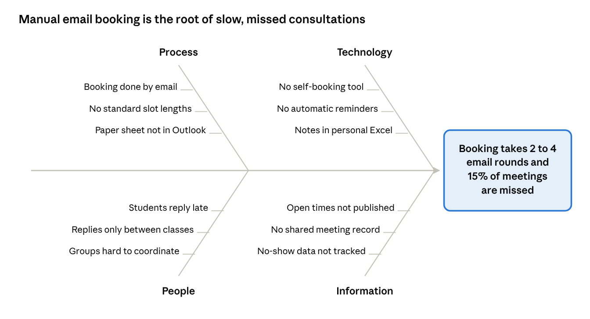
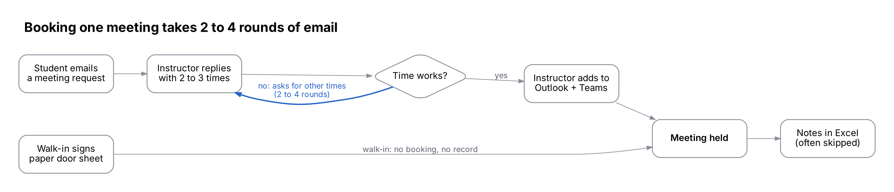

# Deliverable 01 – Business Case Analysis: Instructor Consultation Booking System

**Author:** Md Alamgir Hossain · October 2026 · *Illustrative case study: the stakeholder and all figures are fictional.*

The business case supports building an Instructor Consultation Booking System. Email and paper-sheet booking costs the instructor about 3–4 hours a week, causes double-bookings and leaves no meeting record.

## 1. System request form

The system request is the formal starting point of the project (Chapter 2). Alex submits it as the user and requestor.

| Field               | Entry                                                                                                                                                           |
|---------------------|-----------------------------------------------------------------------------------------------------------------------------------------------------------------|
| Requestor           | Alex Morgan, Instructor BIS                                                                                                                                |
| Department          | School of Business, Business Information Systems (BIS) program                                                                                    |
| Contact             | alex.morgan@college.example                                                                                                                                          |
| Date submitted      | October 2026                                                                                                                                                    |
| Title of request    | Instructor Consultation Booking System                                                                                                                          |
| Type of request     | New system                                                                                                                                                      |
| Main driver         | Improved service to students; reduced instructor workload                                                                                                       |
| Urgency             | Medium. Wanted before the Winter 2027 term.                                                                                                                     |
| Problem description | Consultations are booked by email and a paper door sheet. This causes 2–4 rounds of email per booking, double-bookings, missed meetings and no meeting records. |
| Reason for request  | Save instructor time, give students a faster way to book, and keep a record of every consultation.                                                              |
| Expected benefits   | About 3–4 hours a week of scheduling time saved, fewer no-shows (target: from about 15% to under 5%), a searchable meeting history.                             |
| Constraints         | Very small budget. Must work with Microsoft 365 (Outlook, Teams) and college logins. Must protect student data under provincial privacy law (FOIP).       |

## 2. Problem statement and business case

**Problem statement:** Booking a consultation with the instructor takes 2–4 rounds of email, and about 15% of booked meetings are missed. This wastes 3–4 instructor hours a week at peak times and gives students a slow, unreliable way to get help.

**Current impact (illustrative figures)**

| Issue                                    | Measure               |
|------------------------------------------|-----------------------|
| Booking emails at peak times             | 40–60 per week        |
| Instructor time spent scheduling         | 3–4 hours per week    |
| Double-bookings (paper sheet vs Outlook) | 2–3 per month         |
| Missed meetings (no reminders)           | About 15% of bookings |
| Meetings with notes recorded             | Under half            |

**Business case questions (Chapter 2)**

| Question                                     | Answer                                                                                                                                                          |
|----------------------------------------------|-----------------------------------------------------------------------------------------------------------------------------------------------------------------|
| Why are we doing this project?               | To remove manual scheduling work and improve the student consultation experience.                                                                               |
| What is the project?                         | A web-based booking system where students self-book from the instructor's open slots and get reminders, and the instructor keeps private meeting notes.         |
| How does it support business objectives?     | It supports the college's focus on student success and on using staff time effectively.                                                                       |
| What will it cost and how long will it take? | Low cost if built on the existing Microsoft 365 licence; about 8–10 weeks before Winter 2027. Details in Deliverable 02.                                        |
| What happens if we do nothing?               | The instructor keeps losing 3–4 hours a week, missed meetings continue, student names stay posted on a public door sheet, and there is still no meeting record. |

**Reasons for the systems request (Chapter 2: six main reasons)**

| Reason                                | Applies?          | How                                                                                |
|---------------------------------------|-------------------|------------------------------------------------------------------------------------|
| Improved service                      | Yes (main reason) | Students book online, any time, from any device                                    |
| Better performance                    | Yes               | One online step replaces 2–4 rounds of email                                       |
| More information                      | Yes               | Searchable meeting history and no-show data                                        |
| Stronger controls                     | Yes               | No double-bookings; no student names on a public door sheet; FOIP-compliant access |
| Reduced cost                          | Yes               | Frees about 3.5 instructor hours a week                                            |
| Support for new products and services | No                | The consultation service itself does not change                                    |

**Factors affecting the project (Chapter 2: internal and external)**

| Internal factors                                            | External factors                                                 |
|-------------------------------------------------------------|------------------------------------------------------------------|
| Strategic plan: the college's focus on student success    | Technology: cloud booking tools are now standard and low-cost    |
| Top management: the program head must approve               | Suppliers: Microsoft provides Bookings, Outlook and Teams        |
| User requests: Alex and the students want self-booking    | Customers: students expect self-service and mobile access        |
| IT department: IT Services must enable and support the tool | Competitors: students already self-book with many other services |
| Existing systems: Microsoft 365, D2L Brightspace            | Economy: tight public budgets mean little or no new spending     |
|                                                             | Government: FOIP privacy rules for student information           |

**Project type and priority:** this is a **discretionary** project (management can choose whether to do it), not a nondiscretionary one such as a required tax update. Its priority is **medium-high**: it reduces costs, serves students better, produces more information, can be done in a reasonable time, and uses resources the college already has.

## 3. CATWOE analysis

The team used CATWOE instead of SWOT, as the assignment requires. It looks at the booking problem from each stakeholder's view and focuses on the new functionality.

| Element            | Meaning                     | For this system                                                                                           |
|--------------------|-----------------------------|-----------------------------------------------------------------------------------------------------------|
| **C**ustomers      | Who benefits                | Students and project groups in Alex's sections (about 120–150 a term)                                   |
| **A**ctors         | Who carries out the process | Alex (instructor); later other instructors; IT Services for support                                     |
| **T**ransformation | Input → output              | Booking requests by email or paper → confirmed, self-booked meetings with reminders and records           |
| **W**orldview      | Why it matters              | Instructors should spend their time teaching and advising, not scheduling                                 |
| **O**wner          | Who can approve or stop it  | BIS program, School of Business (program head)                                                         |
| **E**nvironment    | Outside constraints         | Small budget, existing Microsoft 365 and D2L Brightspace, FOIP privacy rules, deadline before Winter 2027 |

**Root definition:** A system owned by the BIS program and used by the instructor, which lets students book consultations themselves from published open slots, so that scheduling time is cut and every meeting is confirmed, reminded and recorded, within the college's existing technology, budget and privacy rules.

## 4. Fishbone (cause-and-effect) diagram

fishbone (Ishikawa) diagram · 4 categories, 12 causes

Most causes trace back to two gaps: there is no tool for students to book themselves, and open times are not published anywhere. A self-booking system with published slots, automatic reminders and a shared meeting record addresses all 12 causes.

## 5. As-is business process model

as-is booking process · 6 steps, 1 loop

The email loop between Alex and the student is the main delay. Walk-ins bypass the calendar entirely, which causes double-bookings, and notes are often skipped, so there is no meeting record.

**Proposed (to-be) process:** Student signs in → picks an open slot → confirms → system sends confirmation and adds the meeting to Outlook with a Teams link → system sends a reminder 24 hours before → meeting held → Alex records notes and status. This removes the email loop and the paper sheet.

---

[← Back to the case study overview](../README.md)
