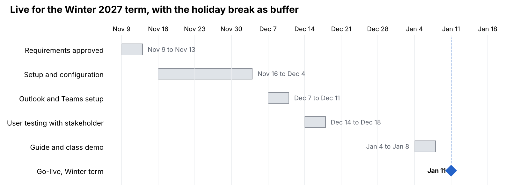

# Deliverable 02 – Feasibility Assessment: Instructor Consultation Booking System

**Author:** Md Alamgir Hossain · October 2026 · *Illustrative case study: Walter Dvorak is the course instructor who acted as stakeholder. The interview answers and all figures here are illustrative examples prepared by the student team, not his actual statements.*

The project is feasible. The recommended option, configuring Microsoft Bookings under the college's existing Microsoft 365 licence, pays back in about 8 months and can be live for the Winter 2027 term. All figures are illustrative estimates for the practice scenario.

## 1. Alternatives considered

The team assessed four options against the requirements in Deliverable 05.

| Option                                        | Description                                                                                                    |
|-----------------------------------------------|----------------------------------------------------------------------------------------------------------------|
| A. Do nothing                                 | Keep booking by email and the paper door sheet                                                                 |
| B. Configure Microsoft Bookings (recommended) | Set up Microsoft Bookings, included in the college's Microsoft 365 licence, with Outlook and Teams integration |
| C. Build a custom web app in-house            | Develop a booking app from scratch (e.g., ASP.NET or Power Apps with a SharePoint list)                        |
| D. Buy a commercial booking service           | Subscribe to an outside scheduling service such as Calendly                                                    |

## 2. Operational feasibility

The system is operationally feasible: both user groups want it, and it fits how the instructor already works.

| Question (Chapter 2)                 | Finding                                                                                                                |
|--------------------------------------|------------------------------------------------------------------------------------------------------------------------|
| Does management support the project? | Yes. Walter is the requestor; the program head is expected to approve because it improves student service at low cost. |
| Will users accept it?                | Yes. 70% of surveyed students prefer self-booking, and Walter asked for it (Deliverable 03).                           |
| Will it change current procedures?   | Yes, for the better: the email loop and paper sheet are replaced. Walter keeps using Outlook and Teams.                |
| Is training needed?                  | Minimal. A one-page quick reference guide (Deliverable 06) and a 10-minute demo in class.                              |
| Will performance improve?            | Yes. Booking time falls from 2–4 email rounds to one online step; reminders target fewer than 5% missed meetings.      |
| Any resistance expected?             | Low. Some students may still email; Walter will reply with the booking link.                                           |

| Further question (Chapter 2)                         | Finding                                                                  |
|------------------------------------------------------|--------------------------------------------------------------------------|
| Will the new system result in a workforce reduction? | No. It frees instructor time for teaching and advising; no jobs are cut. |
| Do legal or ethical issues need to be considered?    | Yes. Student data is covered by FOIP privacy rules (see section 3).      |

| Option                | Operational rating                                                          |
|-----------------------|-----------------------------------------------------------------------------|
| A. Do nothing         | Low: problems continue                                                      |
| B. Microsoft Bookings | High: familiar Microsoft tools, students already use their college accounts |
| C. Custom app         | Medium: new interface to learn, depends on in-house support                 |
| D. Commercial service | Medium: separate account for every student                                  |

## 3. Technical and legal feasibility

Option B is technically feasible with the college's existing technology, and it is the only option that clearly meets the privacy rules.

| Question (Chapter 2)                           | Finding for Option B                                                                                         |
|------------------------------------------------|--------------------------------------------------------------------------------------------------------------|
| Does the college have the technical resources? | Yes. Microsoft Bookings is part of Microsoft 365, which the college already licenses.                      |
| Is the hardware and software in place?         | Yes. Runs in a web browser on any device; no new servers.                                                    |
| Can it integrate with current systems?         | Yes. Bookings syncs with Outlook and creates Teams links automatically; sign-in uses college accounts (SSO). |
| Does the team have the skills?                 | Yes, with IT Services' help to enable Bookings for the instructor's account.                                 |
| Will it meet performance needs?                | Yes. 150 users and about 50 bookings a week is well within Microsoft 365 capacity.                           |

| Further question (Chapter 2)                                           | Finding for Option B                                                                                                 |
|------------------------------------------------------------------------|----------------------------------------------------------------------------------------------------------------------|
| Does the platform have enough capacity for future needs (scalability)? | Yes. Microsoft 365 already serves the whole college, so the system could grow to other instructors without redesign. |
| Will a prototype be required?                                          | Yes. A design (throwaway) prototype, Deliverable 08, is used to confirm the screens with Walter before setup.        |

**Legal feasibility:** Student names, emails and meeting notes are personal information under Saskatchewan's privacy law for public institutions (FOIP). Options B and C keep data inside college-approved systems. Option D would store student data with an outside vendor, possibly outside Canada, and would need a privacy review and contract before use.

| Option                | Technical rating                      | Legal rating                                           |
|-----------------------|---------------------------------------|--------------------------------------------------------|
| A. Do nothing         | n/a                                   | Risk: student names posted on the door                 |
| B. Microsoft Bookings | High                                  | Low risk: college-approved system                      |
| C. Custom app         | Medium: needs development and hosting | Low risk if hosted by the college                      |
| D. Commercial service | High                                  | High risk: outside data storage, privacy review needed |

## 4. Economic feasibility

Option B returns about \$10,170 net over 3 years and pays back in about 8 months. Option C costs more than it saves over the same period.

**Assumptions (illustrative):** instructor time valued at \$50/hour; IT staff time at \$45/hour; 30 teaching weeks a year; 3.5 hours a week saved = 105 hours a year = **\$5,250 a year in tangible benefits**.

**Option B costs (total cost of ownership)**

| Cost item                                       | One-time                        | Per year  |
|-------------------------------------------------|---------------------------------|-----------|
| Microsoft Bookings licence                      | \$0 (included in Microsoft 365) | \$0       |
| Setup and configuration (40 h IT)               | \$1,800                         |           |
| Outlook/Teams integration and testing (16 h IT) | \$720                           |           |
| Quick reference guide and demo (8 h)            | \$360                           |           |
| Ongoing support (20 h IT a year)                |                                 | \$900     |
| **Total**                                       | **\$2,880**                     | **\$900** |

**TCO components checked (Chapter 2)**

| TCO component                        | Option B                                                                     |
|--------------------------------------|------------------------------------------------------------------------------|
| People (IT staff and users)          | 56 h IT setup, 20 h IT a year; about 2 h of Walter's time for testing        |
| Hardware and equipment               | \$0 (existing computers and phones)                                          |
| Software                             | \$0 (Microsoft Bookings is in the existing licence)                          |
| Formal and informal training         | \$360 (quick reference guide and class demo)                                 |
| Licences and fees                    | \$0                                                                          |
| Consulting and facility costs        | \$0                                                                          |
| Cost of not developing or postponing | About \$5,250 a year in lost instructor time, plus continued missed meetings |

**Intangible costs:** a short learning period for Walter and students, some students continuing to email at first, and reliance on IT Services' availability.

**Cost-benefit comparison over 3 years**

| Option                            | One-time cost | Annual cost | Annual benefit | Payback         | 3-year net                                      |
|-----------------------------------|---------------|-------------|----------------|-----------------|-------------------------------------------------|
| A. Do nothing                     | \$0           | \$0         | \$0            | n/a             | \$0 (keeps losing \$5,250 a year in staff time) |
| B. Microsoft Bookings             | \$2,880       | \$900       | \$5,250        | About 8 months  | **+\$10,170**                                   |
| C. Custom app (200 h development) | \$9,000       | \$3,300     | \$5,250        | About 4.6 years | −\$3,150                                        |
| D. Commercial service             | \$360         | \$650       | \$5,250        | About 1 month   | +\$13,440, but fails the legal check            |

**Option B calculations**

- Net annual benefit = \$5,250 − \$900 = \$4,350

- Payback period = \$2,880 ÷ \$4,350 = 0.66 years (about 8 months)

- 3-year costs = \$2,880 + (3 × \$900) = \$5,580; 3-year benefits = 3 × \$5,250 = \$15,750

- 3-year net = \$15,750 − \$5,580 = \$10,170

- ROI = \$10,170 ÷ \$5,580 = **182%**

**Intangible benefits:** better student experience, fewer missed meetings, a searchable meeting history, and no student names posted publicly.

## 5. Schedule feasibility

Option B schedule · 5 tasks, go-live Jan 11, 2027

Option B takes about 9 weeks, including the holiday break, so it can go live in the first week of the Winter 2027 term. If setup slips, the 2-week break absorbs the delay.

| Schedule question (Chapter 2)                              | Finding                                                                                 |
|------------------------------------------------------------|-----------------------------------------------------------------------------------------|
| Can the team control the factors that affect the schedule? | Partly. Setup is in our control; IT Services approval is not, so it is requested first. |
| Has management set a firm timetable?                       | Yes. The system must be live for the first week of the Winter 2027 term.                |
| What conditions must be met?                               | Bookings enabled for Walter's account; prototype approved; testing passed.              |
| Would an accelerated schedule add risk?                    | Yes. Cutting the testing week could let booking errors reach students.                  |
| Are project management techniques available?               | Yes. The timeline above, weekly check-ins and a task list track progress.               |

## 6. Feasibility summary and recommendation

**Recommendation: Option B, configure Microsoft Bookings.** It is the only option that passes all five feasibility tests.

| Option                | Operational | Technical | Economic | Schedule                                   | Legal     | Overall                               |
|-----------------------|-------------|-----------|----------|--------------------------------------------|-----------|---------------------------------------|
| A. Do nothing         | Low         | n/a       | Low      | n/a                                        | Risk      | Not feasible                          |
| B. Microsoft Bookings | High        | High      | High     | High                                       | Low risk  | **Feasible (recommended)**            |
| C. Custom app         | Medium      | Medium    | Low      | Low: 200 h will not fit before Winter 2027 | Low risk  | Not feasible now                      |
| D. Commercial service | Medium      | High      | High     | High                                       | High risk | Not feasible without a privacy review |

The team recommends that the program head approve Option B and that IT Services enable Microsoft Bookings for Walter's account. These findings feed the Preliminary Investigation Report (Deliverable 04).

---

[← Back to the case study overview](../README.md)
