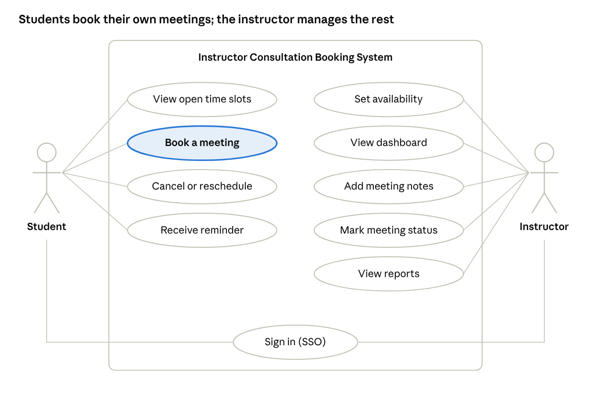

# Deliverable 05 – Final Requirements: Instructor Consultation Booking System

**Author:** Md Alamgir Hossain · October 2026 · *Illustrative case study: the stakeholder and all figures are fictional.*

These are the final requirements for the Instructor Consultation Booking System, the input for the team's GUI prototype (Deliverable 08). They are based on an illustrative stakeholder scenario.

## 1. Purpose and scope

The system lets students and project groups book consultations with an instructor online, without email back-and-forth. It replaces the current email and paper door-sheet process.

- **System:** Instructor Consultation Booking System

- **Requestor and primary user:** Alex Morgan, Instructor, Business Information Systems (fictional stakeholder)

- **Other users:** Students and project groups in Alex's course sections (about 120–150 a term)

- **Business objective:** Cut instructor scheduling time by 3–4 hours a week, reduce missed meetings and keep a record of every consultation

**In scope:**

- Publishing the instructor's available time slots

- Student self-booking, rescheduling and cancelling

- Confirmations and reminders

- Instructor dashboard and private meeting notes

- Basic usage reports

**Out of scope (this release):**

- Use by other instructors or departments

- Grading or course content (stays in D2L Brightspace)

- Mobile app (the web interface must still work on phones)

## 2. Fact-finding techniques used

The requirements come from two techniques, which meets the assignment's "no less than two techniques" rule.

| Technique     | Who                                                | What it gave us                                                                 | Reference                                |
|---------------|----------------------------------------------------|---------------------------------------------------------------------------------|------------------------------------------|
| Interview     | Alex Morgan (30 min, during class time) | Duties, current systems, pain points, must-have and nice-to-have features       | Deliverable 03, interview summary Q1–Q10 |
| Questionnaire | 30 students                                        | 80% find email booking slow; 70% prefer self-booking; 60% have missed a meeting | Deliverable 03, questionnaire results    |

In the tables below, the **Source** column points back to these: "INT-Q6" means interview question 6, and "QST" means the student questionnaire.

## 3. Requirements checklist (Chapter 4 categories)

The system requirements checklist groups the needs into the five categories from the textbook's Chapter 4.

**Outputs**

- The booking page must show the instructor's open slots for the next 4 weeks.

- The system must send a booking confirmation by email within 1 minute of booking.

- The system must send a reminder email 24 hours before each meeting.

- The instructor dashboard must list today's and this week's meetings.

- The system must produce a monthly summary report (meetings held, cancellations, no-shows) and an exception report of no-shows.

**Inputs**

- The instructor must be able to enter office hours, slot lengths (15 or 30 minutes) and blocked dates.

- Students must book by choosing a slot and entering a meeting type, a short topic (up to 200 characters) and, for groups, the group name.

- Student name, email and ID must come from the the college login, not be typed in.

- The instructor must be able to enter private notes after each meeting.

**Processes**

- The system must prevent double-booking of the same slot.

- Students must be able to cancel or reschedule up to 2 hours before a meeting.

- The system must create a Teams link automatically for online meetings.

- The system must sync confirmed meetings to the instructor's Outlook calendar.

- The instructor must be able to mark each meeting as held, cancelled or no-show.

*Processing method (Chapter 8 input technology):* booking, cancelling, double-booking checks and confirmations use **online processing**, so results are immediate. Reminder emails, monthly reports and backups run as scheduled **batch processing**.

**Performance**

- Pages must load in under 3 seconds.

- The system must support up to 150 student users a term and 50 bookings a week.

- The system must be available 99% of the time during the academic term.

**Controls**

- Users must sign in with their college account (single sign-on).

- Students must see only their own bookings; meeting notes must be visible only to the instructor.

- Student data must be handled under provincial privacy law (FOIP).

- The system must log every booking, change and cancellation with a date and time.

## 4. Functional requirements

Functional requirements say what the system must do. Nine are Must have; the prototype must show all of them.

| ID    | Requirement                                                                       | Source         | Priority                  | Acceptance criterion                                                                |
|-------|-----------------------------------------------------------------------------------|----------------|---------------------------|-------------------------------------------------------------------------------------|
| FR-01 | Show the instructor's available slots for the next 4 weeks                        | INT-Q6, QST    | Must have                 | Students see only open slots; booked slots are hidden                               |
| FR-02 | Let the instructor set office hours, slot length (15 or 30 min) and blocked dates | INT-Q4, INT-Q5 | Must have                 | A change shows on the booking page immediately                                      |
| FR-03 | Let a student or group book a slot with a meeting type and short topic            | INT-Q6, QST    | Must have                 | The booking is saved and the slot is no longer available                            |
| FR-04 | Prevent double-booking of a slot                                                  | INT-Q3         | Must have                 | If two users pick the same slot, the second sees "This slot is no longer available" |
| FR-05 | Send a booking confirmation email                                                 | INT-Q6         | Must have                 | Sent within 1 minute, with date, time and location or Teams link                    |
| FR-06 | Send a reminder email 24 hours before the meeting                                 | INT-Q6, QST    | Must have                 | Sent 24 hours (±15 min) before every confirmed meeting                              |
| FR-07 | Let students cancel or reschedule up to 2 hours before                            | INT-Q6         | Must have                 | The slot is released and the instructor is notified                                 |
| FR-08 | Give the instructor a dashboard of today's and this week's meetings               | INT-Q1         | Must have                 | Meetings are listed in time order with student or group name and topic              |
| FR-09 | Let the instructor add private notes to each meeting                              | INT-Q6, INT-Q8 | Must have                 | Notes are saved, searchable and visible only to the instructor                      |
| FR-10 | Let the instructor mark a meeting as held, cancelled or no-show                   | INT-Q10        | Should have               | The status is saved and used in the reports                                         |
| FR-11 | Create a Teams link automatically for online meetings                             | INT-Q7         | Should have               | Every online booking's confirmation includes a working Teams link                   |
| FR-12 | Sync confirmed meetings to the instructor's Outlook calendar                      | INT-Q2         | Should have               | The meeting appears in Outlook within 5 minutes                                     |
| FR-13 | Show the full meeting history for one project group                               | INT-Q7         | Could have                | Filtering by group name lists all of that group's meetings                          |
| FR-14 | Produce a monthly summary report and a no-show exception report                   | INT-Q10        | Could have                | Reports can be viewed on screen and exported to Excel or PDF                        |
| FR-15 | Support booking for other instructors                                             | Scope decision | Won't have (this release) | Deferred to a later release                                                         |

## 5. Non-functional requirements

Non-functional requirements say how well the system must work. Usability and privacy matter most, because students will use it without training and it holds student data.

| ID     | Category      | Requirement                                                                                                                        | Source          | Priority    |
|--------|---------------|------------------------------------------------------------------------------------------------------------------------------------|-----------------|-------------|
| NFR-01 | Usability     | A first-time student can book a meeting in under 2 minutes with no training                                                        | QST             | Must have   |
| NFR-02 | Usability     | The interface follows the Chapter 8 guidelines: consistent layout, clear labels, dimmed unavailable options, easy error correction | Course guidance | Must have   |
| NFR-03 | Security      | Sign-in uses the college account (single sign-on); no separate passwords                                                     | INT-Q9          | Must have   |
| NFR-04 | Privacy       | Students see only their own bookings; notes are instructor-only; data handled under FOIP                                           | INT-Q8          | Must have   |
| NFR-05 | Compatibility | Works with Microsoft 365 (Outlook, Teams) already licensed by the college                                                          | INT-Q9          | Must have   |
| NFR-06 | Performance   | Pages load in under 3 seconds for up to 150 users a term                                                                           | Team estimate   | Should have |
| NFR-07 | Accessibility | Works on phones, tablets and desktops (responsive design) and meets basic accessibility standards                                  | QST             | Must have   |
| NFR-08 | Reliability   | Available 99% of the time during the term; bookings backed up daily                                                                | Team estimate   | Should have |
| NFR-09 | Scalability   | Can grow to other BIS instructors (up to about 20 instructors and 2,000 students) without redesign or loss of speed             | INT-Q11         | Should have |
| NFR-10 | Integration   | Booking page reachable from the instructor's Brightspace course page and the college portal; works with Outlook and Teams          | INT-Q12         | Should have |

## 6. User stories

The user stories restate the Must-have requirements from each user's point of view, in the standard "As a…, I want…, so that…" format.

| ID    | User story                                                                                                                   | Linked requirements |
|-------|------------------------------------------------------------------------------------------------------------------------------|---------------------|
| US-01 | As a **student**, I want to see the instructor's open time slots, so that I can pick a time without emailing back and forth. | FR-01               |
| US-02 | As a **student**, I want to book a slot myself and get a confirmation, so that I know my meeting is set.                     | FR-03, FR-05        |
| US-03 | As a **student**, I want a reminder the day before, so that I don't miss the meeting.                                        | FR-06               |
| US-04 | As a **student**, I want to cancel or reschedule online, so that the slot is freed for someone else.                         | FR-07               |
| US-05 | As a **project group lead**, I want to book a 30-minute group meeting, so that the whole team can meet the instructor.       | FR-02, FR-03        |
| US-06 | As an **instructor**, I want to set my office hours and block dates, so that students only book when I'm available.          | FR-02               |
| US-07 | As an **instructor**, I want a dashboard of today's meetings, so that I can prepare without searching my email.              | FR-08               |
| US-08 | As an **instructor**, I want private notes on each meeting, so that I can follow up on what we discussed.                    | FR-09               |
| US-09 | As an **instructor**, I want double-bookings blocked, so that I'm never scheduled for two meetings at once.                  | FR-04               |

## 7. Use case diagram

use case diagram · 2 actors, 10 use cases

Both actors sign in with their college account. "Book a meeting" is the core use case; the other student use cases support it, and the instructor's use cases replace today's email and Excel work.

| Use case             | Actor      | Main steps                                                                                                                 | Linked requirements        |
|----------------------|------------|----------------------------------------------------------------------------------------------------------------------------|----------------------------|
| Book a meeting       | Student    | 1\. Sign in. 2. Pick an open slot. 3. Choose meeting type and enter topic. 4. Confirm. 5. Receive confirmation email.      | FR-01, FR-03, FR-04, FR-05 |
| Cancel or reschedule | Student    | 1\. Open My bookings. 2. Choose Cancel or Reschedule. 3. Pick a new slot if rescheduling. 4. Receive updated confirmation. | FR-07                      |
| Set availability     | Instructor | 1\. Open Availability settings. 2. Set office hours and slot length. 3. Block dates. 4. Save.                              | FR-02                      |
| Add meeting notes    | Instructor | 1\. Open a meeting from the dashboard. 2. Type notes. 3. Mark status. 4. Save.                                             | FR-09, FR-10               |

## 8. Traceability to the GUI prototype (Deliverable 08)

Every Must-have requirement maps to at least one prototype screen, so the GUI team knows exactly what each screen has to show.

| Screen                           | User       | Key elements                                                                                                   | Requirements covered         |
|----------------------------------|------------|----------------------------------------------------------------------------------------------------------------|------------------------------|
| S1 Booking calendar              | Student    | Week view, open slots highlighted, booked slots dimmed, meeting-type filter                                    | FR-01, FR-04, NFR-01, NFR-02 |
| S2 Booking form and confirmation | Student    | Selected slot, meeting type (individual or group), topic box, group name, Confirm button, confirmation message | FR-03, FR-05, FR-11          |
| S3 My bookings                   | Student    | Upcoming meetings list, Reschedule and Cancel buttons, cut-off warning                                         | FR-06, FR-07                 |
| S4 Instructor dashboard          | Instructor | Today and this week, meeting cards, status buttons (held, cancelled, no-show)                                  | FR-08, FR-10, FR-12          |
| S5 Availability settings         | Instructor | Office hours, slot length, blocked dates                                                                       | FR-02                        |
| S6 Meeting notes and history     | Instructor | Notes box, search, filter by group                                                                             | FR-09, FR-13                 |
| S7 Reports                       | Instructor | Monthly summary, no-show exception report, export                                                              | FR-14                        |

Screens S1–S6 cover all the Must-have requirements, so they are the minimum set for the prototype; S7 can be added if time allows.

## 9. Assumptions, constraints and open questions

**Assumptions**

- Students and the instructor all have college Microsoft 365 accounts.

- Meetings are 15 minutes for individuals and 30 minutes for groups.

- Office hours are Tuesdays and Thursdays, 1–3 pm, plus extra slots the instructor adds.

**Constraints**

- Little or no budget; the solution should use tools the college already licenses.

- It must be ready before the Winter 2027 term.

- Student data must stay within college-approved systems (FOIP).

**Open questions (to confirm with the stakeholder)**

- [ ] Is a 2-hour cancellation cut-off acceptable?

- [ ] Should students be limited to a number of bookings per week?

- [ ] Does Alex want walk-ins recorded in the system too?

- [ ] Will IT Services allow Outlook and Teams integration?

## 10. Validation, verification and requirements challenges

The requirements were checked in two ways before being used for the prototype (Chapter 4: V&V).

| Check            | Question                                                                         | How we did it                                                                                                        |
|------------------|----------------------------------------------------------------------------------|----------------------------------------------------------------------------------------------------------------------|
| **Validation**   | Are the *correct* requirements stated? (Is this the system Alex really wants?) | Walk Alex through the user stories and the prototype screens, and ask him to sign off (section 12)                 |
| **Verification** | Are the requirements stated *correctly*? (Clear, testable, consistent?)          | Every requirement has an ID, a source and an acceptance criterion; the traceability table links each one to a screen |

| Challenge (Chapter 4) | Risk here                                         | How we handle it                                                                                               |
|-----------------------|---------------------------------------------------|----------------------------------------------------------------------------------------------------------------|
| Imprecision           | Vague wishes like "easy booking"                  | Measurable acceptance criteria (e.g., "book in under 2 minutes")                                               |
| Agreement             | Alex and students may want different things     | Interview plus questionnaire; MoSCoW priorities agreed with Alex                                             |
| Creep                 | New features added late (e.g., other instructors) | Out-of-scope list and "Won't have (this release)" priority; scalability (NFR-09) keeps the door open for later |

## 11. Glossary of terms

Plain-language meanings of the technical terms and abbreviations used in this document.

| Term                            | Meaning                                                                                                                                                                                     |
|---------------------------------|---------------------------------------------------------------------------------------------------------------------------------------------------------------------------------------------|
| Acceptance criterion            | A clear, testable condition that shows a requirement has been met (e.g., "email sent within 1 minute").                                                                                     |
| Actor                           | In a use case diagram, a person or system that interacts with the system (here: Student and Instructor).                                                                                    |
| D2L Brightspace                 | The college's learning management system, where course content, dropboxes and grades are kept.                                                                                              |
| Dashboard                       | A single screen that summarizes key information at a glance, such as today's meetings.                                                                                                      |
| Exception report                | A report that shows only records needing attention, such as meetings marked as no-show.                                                                                                     |
| FOIP                            | Saskatchewan's Freedom of Information and Protection of Privacy rules, which govern how public institutions collect, use and protect personal information such as student names and emails. |
| FR / NFR                        | Functional requirement (what the system must do) / non-functional requirement (how well it must do it: speed, security, usability).                                                         |
| INT-Q / QST                     | Source codes in this document: INT-Q6 = interview question 6 with Alex; QST = the student questionnaire.                                                                                  |
| Microsoft 365                   | The college's suite of Microsoft tools, including Outlook (email and calendar) and Teams (online meetings).                                                                                 |
| MoSCoW                          | A way to prioritize requirements: **M**ust have, **S**hould have, **C**ould have, **W**on't have (this release).                                                                            |
| No-show                         | A booked meeting the student or group did not attend without cancelling.                                                                                                                    |
| Responsive design               | A layout that adjusts automatically to the screen size, so the same system works on phones, tablets and computers.                                                                          |
| Single sign-on (SSO)            | Signing in once with your existing college username and password, instead of creating a separate account and password for this system.                                                |
| Slot                            | A fixed block of time the instructor makes available for booking (15 minutes for individuals, 30 minutes for groups).                                                                       |
| Summary report                  | A report showing totals rather than individual records, such as meetings held per month.                                                                                                    |
| Traceability                    | Linking each requirement to its source and to the screen that delivers it, so nothing is missed or added without reason.                                                                    |
| Use case                        | A description of one task a user performs with the system, step by step (e.g., "Book a meeting").                                                                                           |
| User story                      | A short requirement written from the user's view: "As a \[user\], I want \[goal\], so that \[reason\]."                                                                                     |
| 99% availability                | The system is working and usable at least 99% of the time during the term (about 7 hours of downtime a month at most).                                                                      |
| Integration point               | A place where the system connects to another system the college already uses, such as Brightspace, the college portal, Outlook or Teams.                                                    |
| Online / batch processing       | Online: each transaction is processed immediately (booking a slot). Batch: transactions are grouped and processed on a schedule (reminders, monthly reports).                               |
| Scalability                     | The system's ability to handle more users, data and transactions without slowing down or being redesigned.                                                                                  |
| Validation / verification (V&V) | Validation: are the correct requirements stated? Verification: are the requirements stated correctly?                                                                                       |

## 12. Sign-off

The requirements are final once the user confirms them below.

| Role             | Name                                    | Signature | Date |
|------------------|-----------------------------------------|-----------|------|
| User / requestor | Alex Morgan, Instructor BIS        |           |      |
| Prepared by      | Md Alamgir Hossain, project team |           |      |

---

[← Back to the case study overview](../README.md)
