# Deliverable 07 – Prototype Presentation

A 13-slide presentation that walks the stakeholder through the problem, the improved GUI screen by screen, and how the design follows the Chapter 8 interface guidelines. It ends with the recommendation.

**Download:** [PowerPoint (.pptx)](Prototype_Presentation.pptx) · [PDF](Prototype_Presentation.pdf)
*The PowerPoint version has speaker notes on every slide. Its slides are images, so the text isn't editable.*

| # | Slide | What it shows |
| --- | --- | --- |
| 1 | Cover | Project title and purpose |
| 2 | The problem | 2–4 email rounds per booking, 3–4 h a week lost, 15% of meetings missed |
| 3 | Before vs after | Email-and-paper process compared with self-booking |
| 4–8 | Screens S1–S6 | Each screen with its improvements and the requirements it covers |
| 9 | Seven habits | How the team worked, plus the prototype type (design/throwaway) |
| 10 | 10 UI guidelines | Where each Chapter 8 guideline appears in the prototype |
| 11 | Validation rules | Existence, range, validity, combination and data type checks |
| 12 | Requirements coverage | All nine Must-have requirements shown in the prototype |
| 13 | Recommendation | Microsoft Bookings: $2,880 one-time, about 8-month payback, go-live in January |

## Slides

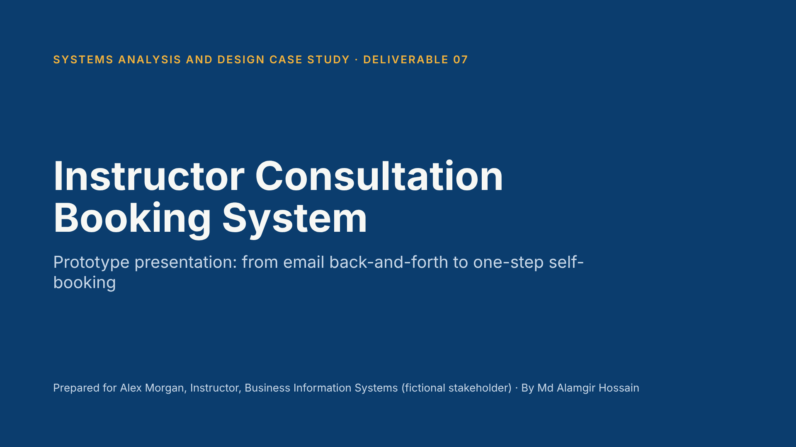
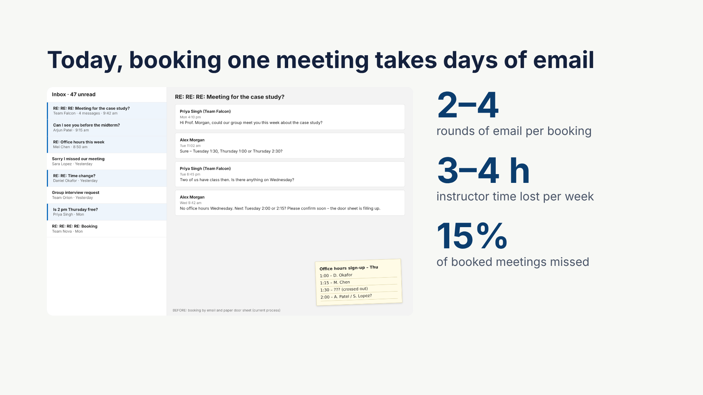
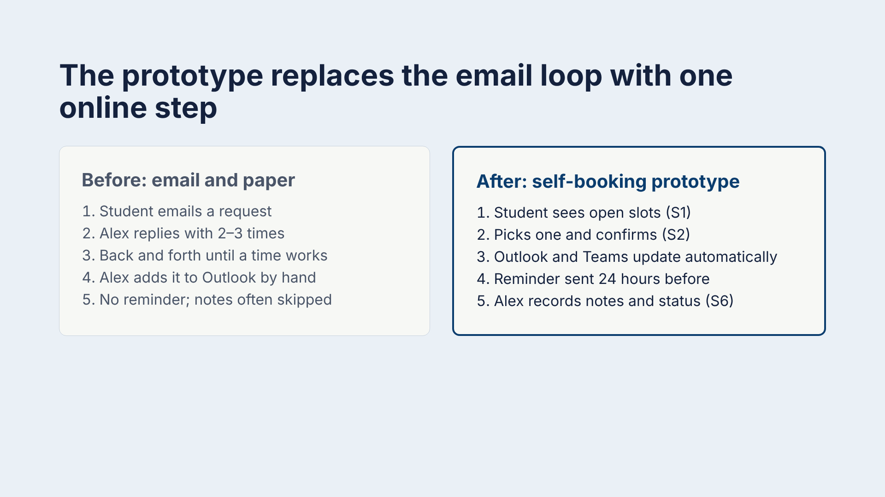
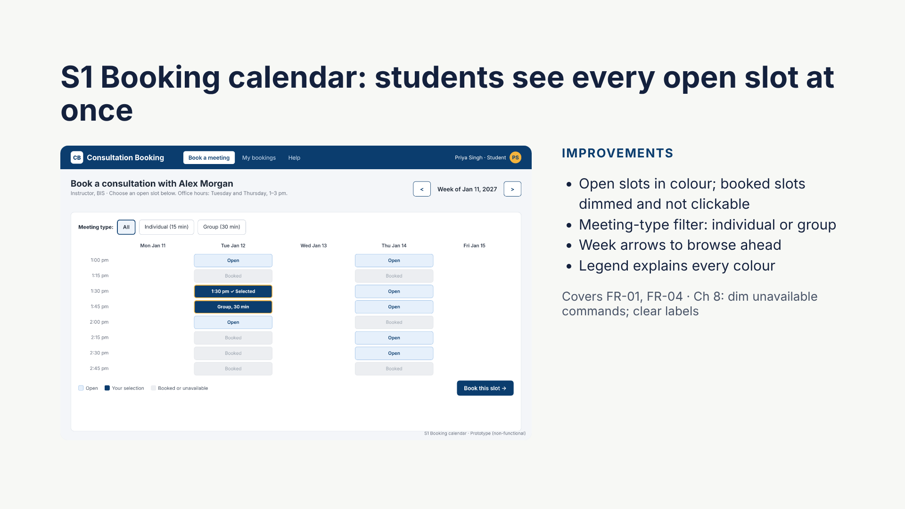
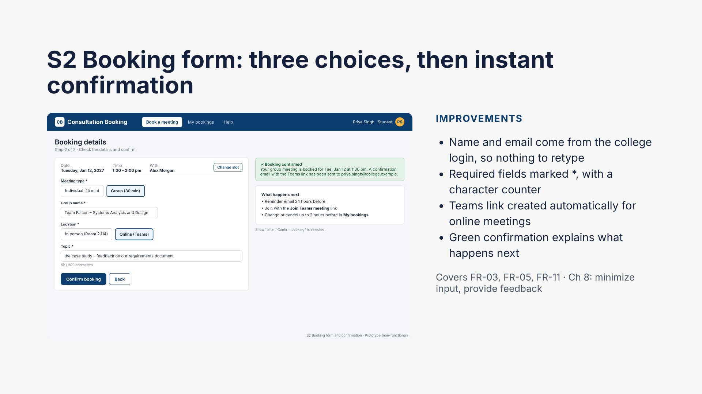
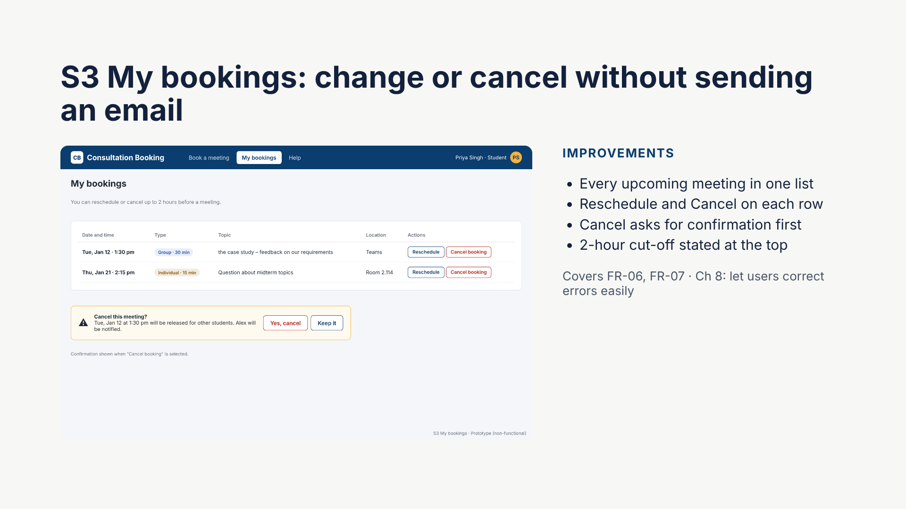
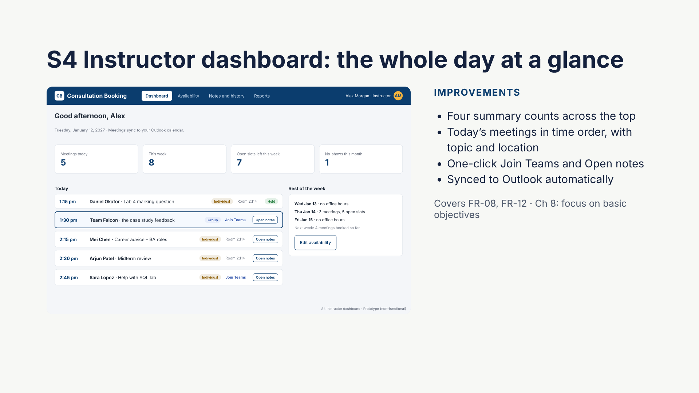
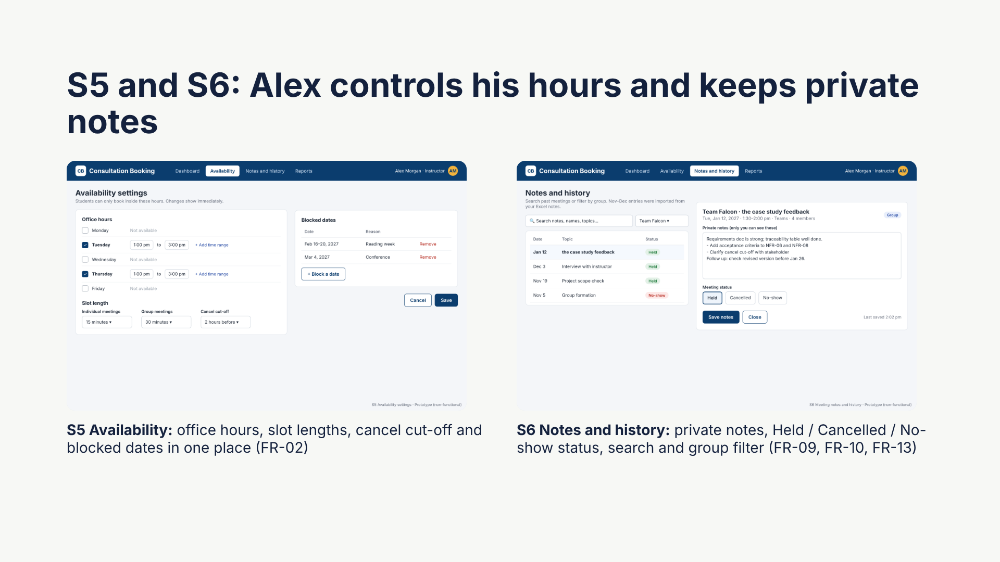
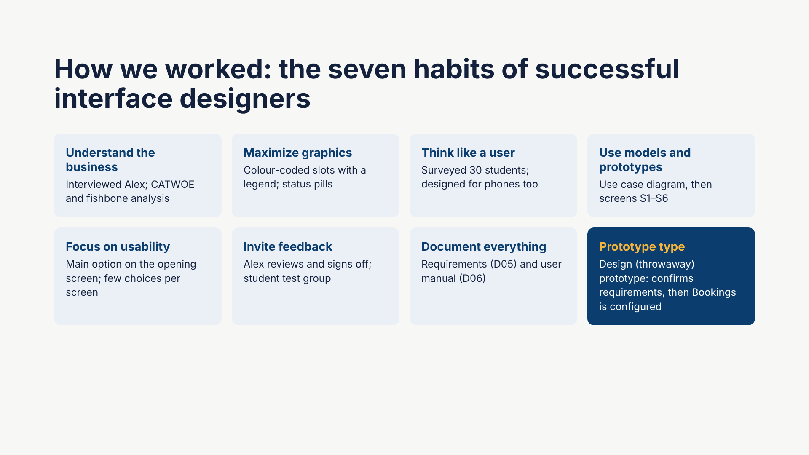
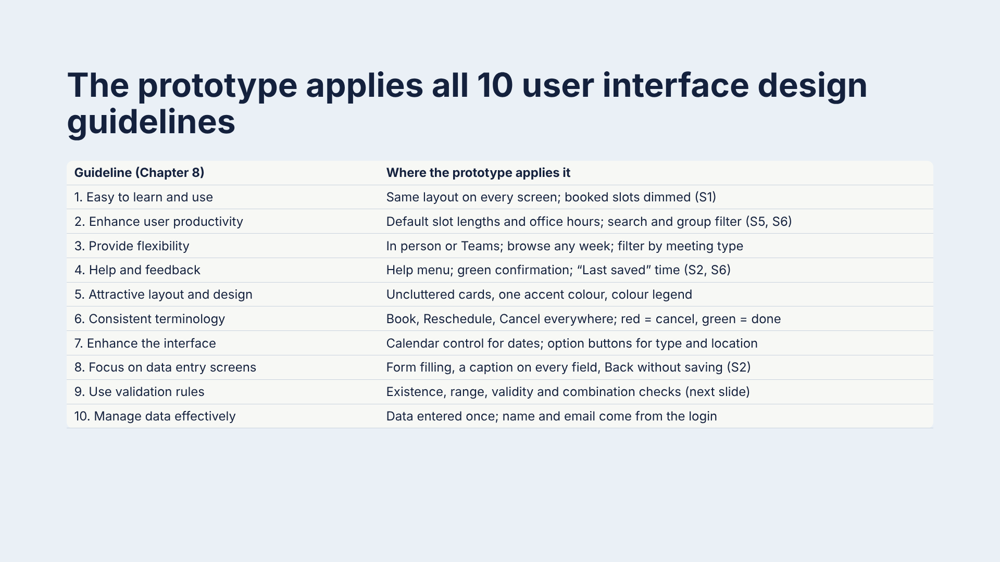
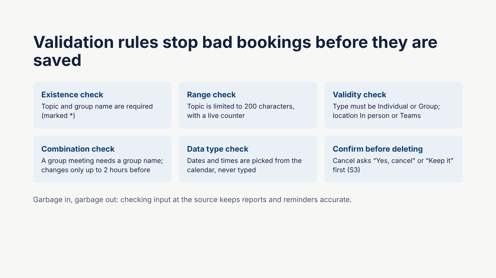
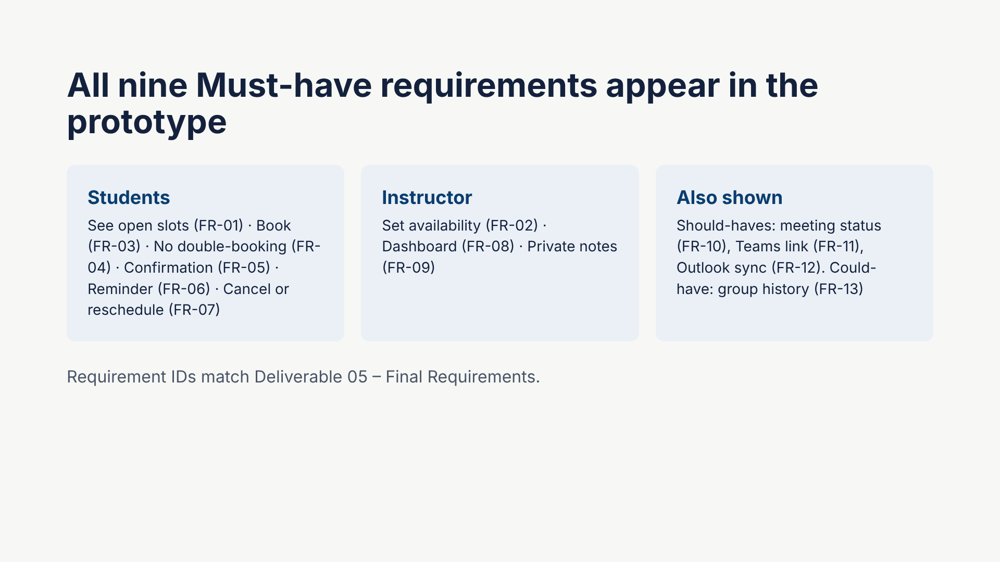
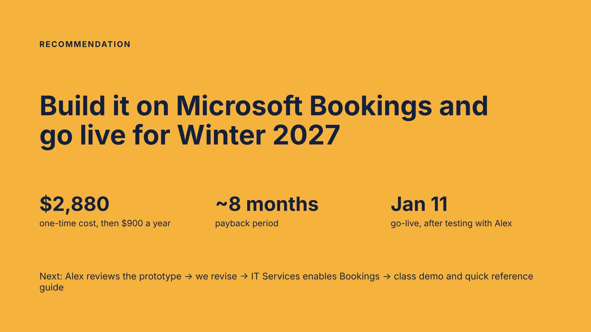

---

[← Back to the case study overview](../README.md)
