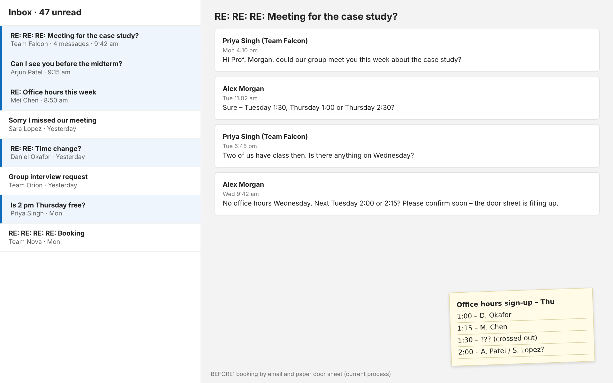
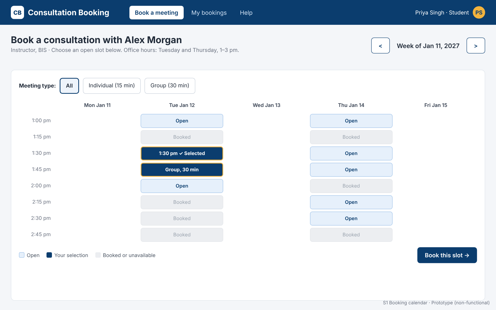
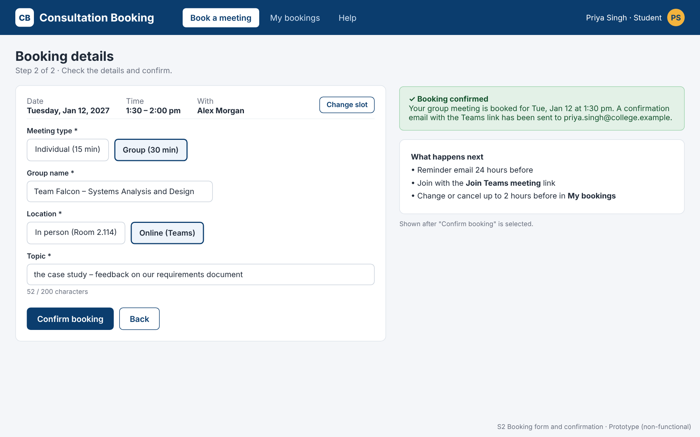
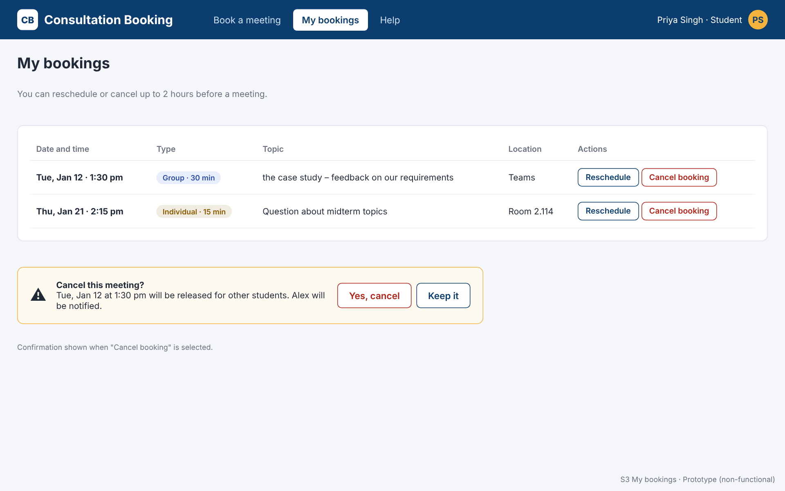
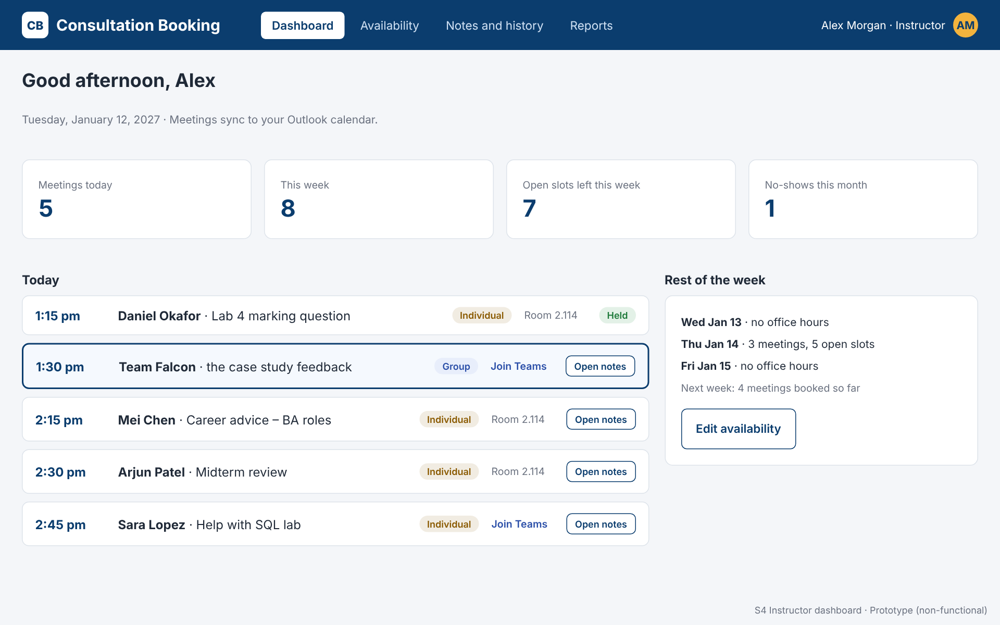
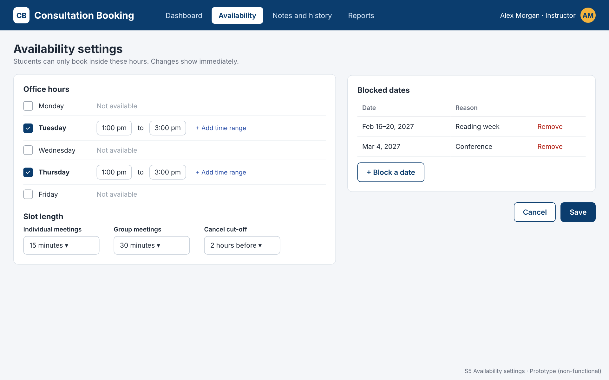
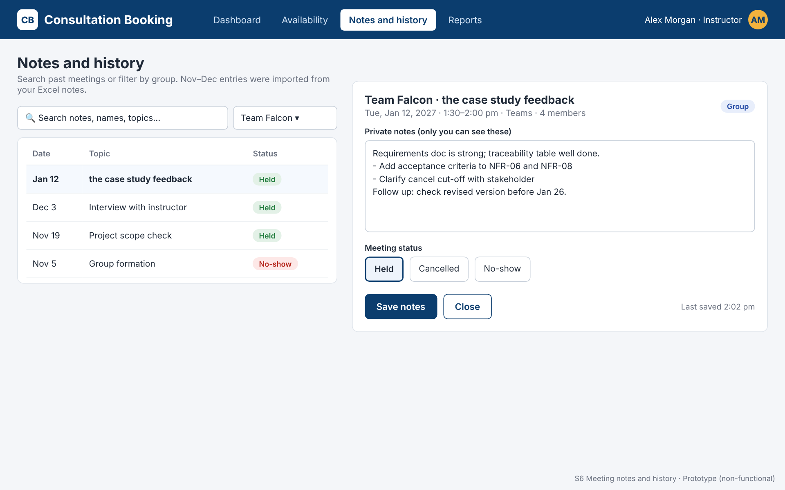

# Deliverable 08 – GUI Prototype

A **non-functional design (throwaway) prototype**: six screen images that show how the improved interface works. Their job is to confirm requirements with the stakeholder before the real system is configured. Each screen traces back to the requirements in [Deliverable 05](../05_Final_Requirements/README.md).

## Before: the current process

Booking happens through email threads and a paper sign-up sheet on the office door.

## After: the prototype screens

| Screen | User | Purpose | Requirements |
| --- | --- | --- | --- |
| [S1 Booking calendar](screens/S1_Booking_Calendar.png) | Student | See open slots; booked slots dimmed | FR-01, FR-04 |
| [S2 Booking form and confirmation](screens/S2_Booking_Form_Confirmation.png) | Student | Choose type, location, topic; instant confirmation | FR-03, FR-05, FR-11 |
| [S3 My bookings](screens/S3_My_Bookings.png) | Student | Reschedule or cancel up to 2 hours before | FR-06, FR-07 |
| [S4 Instructor dashboard](screens/S4_Instructor_Dashboard.png) | Instructor | Today’s meetings at a glance, synced to Outlook | FR-08, FR-12 |
| [S5 Availability settings](screens/S5_Availability_Settings.png) | Instructor | Office hours, slot lengths, blocked dates | FR-02 |
| [S6 Meeting notes and history](screens/S6_Meeting_Notes_History.png) | Instructor | Private notes, status, search, group filter | FR-09, FR-10, FR-13 |

### S1 Booking calendar

### S2 Booking form and confirmation

### S3 My bookings

### S4 Instructor dashboard

### S5 Availability settings

### S6 Meeting notes and history

## Design decisions

The screens follow the user interface guidelines from Chapter 8 of *Systems Analysis and Design*:

- **Consistent and predictable:** the same header, navigation, colours and button styles on every screen.
- **Dim what isn’t available:** booked slots are greyed out and can’t be clicked.
- **Easy to correct errors:** Change slot, Reschedule, and Cancel with a confirmation step.
- **Minimize input:** name and email come from the college sign-in (SSO), not typed in.
- **Feedback:** a green confirmation after booking and a “Last saved” time on notes.
- **Familiar colours:** red = cancel, amber = warning, green = success.
- **Validation rules:** existence (required fields *), range (200-character topic), validity (fixed choices) and combination (group meetings need a group name; changes close 2 hours before).

## Edit or regenerate the screens

The screens are plain HTML and CSS, with no build tools needed:

1. Open [`source/screens.html`](source/screens.html) in any web browser to see all six screens on one page.
2. Edit the text or styles in a code editor and refresh the browser.
3. Take a screenshot of each 1280 × 800 screen, or use any browser screenshot tool.

`source/before_email_booking.html` produces the “before” image the same way.

*All names (stakeholder and students) are fictional.*

---

[← Back to the case study overview](../README.md)
