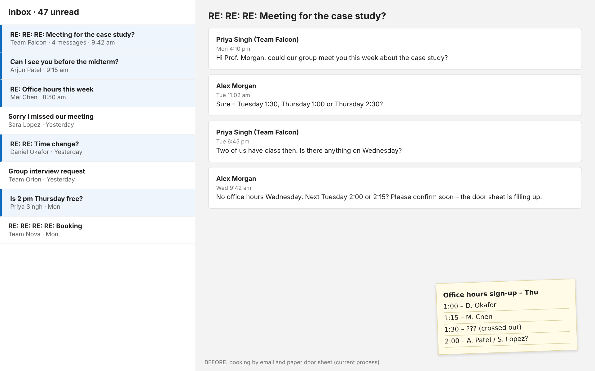
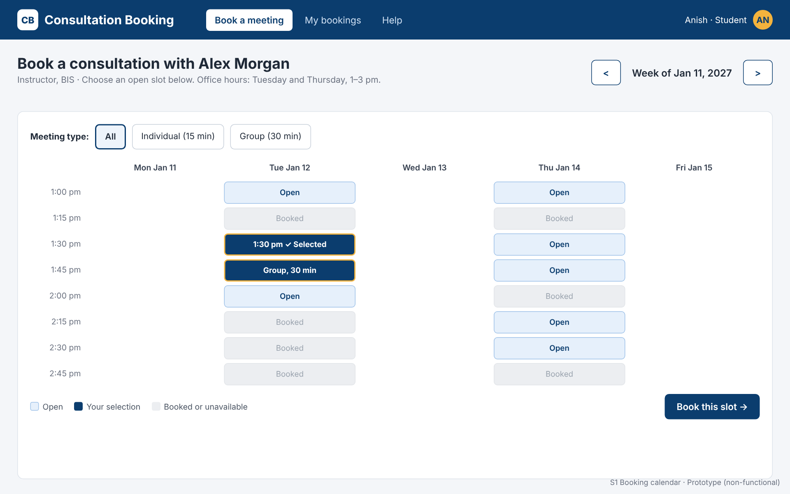
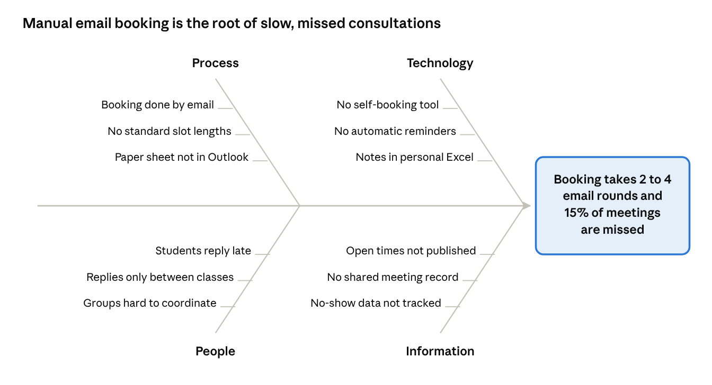
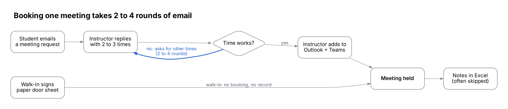
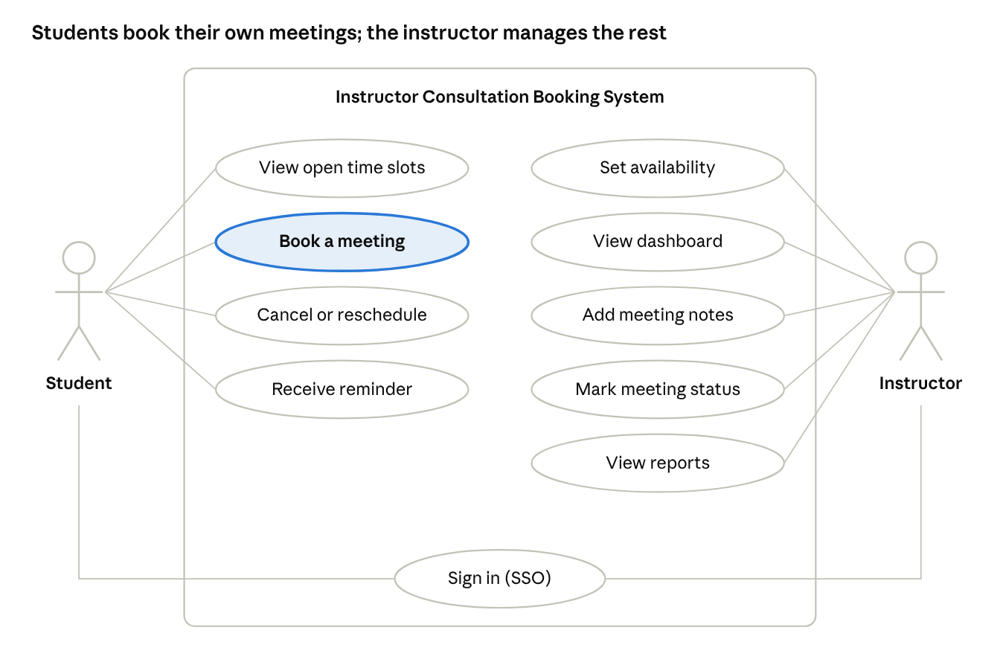
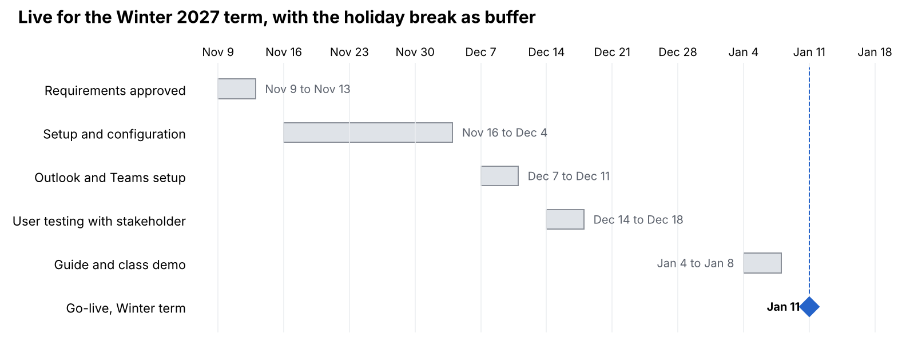

# Instructor Consultation Booking System: Systems Analysis & Design Case Study

**An end-to-end business analysis case study.** It goes from a stakeholder's system request through a business case, feasibility study, requirements engineering, a GUI prototype and a final recommendation.

**Author:** Md Alamgir Hossain · October 2026

> **About this case study.** It was developed for a group project in a Business Information Systems diploma (Systems Analysis and Design). The stakeholder, **Alex Morgan**, and all students, interview answers and figures are **fictional and illustrative**. The structure, methods and templates are real and reusable.

---

## The problem in one picture

An instructor schedules student consultations by email and a paper sign-up sheet on the office door.

| Measure | Today |
| --- | --- |
| Emails per booking | 2–4 rounds |
| Instructor time lost | 3–4 hours a week |
| Missed meetings | About 15% |
| Meeting records | Rarely kept |



## The solution

A self-booking system, recommended to be built on **Microsoft Bookings** using the college's existing Microsoft 365 licence:

- **For students:** see open slots, book themselves, get reminders, reschedule or cancel online.
- **For the instructor:** a dashboard of today's meetings and private meeting notes, synced to Outlook and Teams.

[](https://alamgircanb.github.io/Business-Analysis-Data-Analytics-Intelligence/SystemsAnalysis_CaseStudy_ConsultationBooking/08_GUI_Prototype/prototype/)

**▶ [Try the clickable prototype](https://alamgircanb.github.io/Business-Analysis-Data-Analytics-Intelligence/SystemsAnalysis_CaseStudy_ConsultationBooking/08_GUI_Prototype/prototype/)**: book, cancel, and switch to the instructor view.

**Recommendation in numbers (illustrative):** $2,880 one-time and $900 a year · payback in about 8 months · 182% ROI over 3 years · live for the Winter 2027 term.

---

## The eight deliverables

The work follows the systems development life cycle (SDLC), from planning through analysis to design. Each folder has a readable page (it opens on GitHub) and a downloadable file.

| # | Deliverable | What's inside | Techniques used | Download |
| --- | --- | --- | --- | --- |
| 01 | [Business Case Analysis](01_Business_Case_Analysis/README.md) | System request form, problem statement, business case questions, CATWOE, fishbone diagram, as-is process | CATWOE (instead of SWOT), Ishikawa diagram, process modelling | [.docx](01_Business_Case_Analysis/Business_Case_Analysis.docx) |
| 02 | [Feasibility Assessment](02_Feasibility_Assessment/README.md) | Four alternatives; operational, technical, legal, economic and schedule feasibility | Cost-benefit analysis, TCO, payback, ROI, timeline | [.docx](02_Feasibility_Assessment/Feasibility_Assessment.docx) |
| 03 | [Interview & Fact-Finding](03_Interview_and_Fact_Finding/README.md) | Interview plan, agenda, 15 questions, interview summary, student questionnaire, emails, sign-off | Structured interview, questionnaire, document review, sampling | [.docx](03_Interview_and_Fact_Finding/Interview_and_Fact_Finding.docx) |
| 04 | [Preliminary Investigation Report](04_Preliminary_Investigation_Report/README.md) | Cover memo plus full report: findings, recommendation, project roles, time and cost, benefits | Management reporting | [.docx](04_Preliminary_Investigation_Report/Preliminary_Investigation_Report.docx) |
| 05 | [Final Requirements](05_Final_Requirements/README.md) | Requirements checklist, 15 functional and 10 non-functional requirements, user stories, use case diagram, traceability, V&V, glossary | MoSCoW prioritization, user stories, UML use case, traceability matrix | [.docx](05_Final_Requirements/Final_Requirements.docx) |
| 06 | [User Manual & Quick Reference](06_User_Manual/README.md) | Student and instructor guides, one-page quick reference, FAQ, error messages | User documentation | [.docx](06_User_Manual/User_Manual_and_Quick_Reference.docx) |
| 07 | [Prototype Presentation](07_Prototype_Presentation/README.md) | 13-slide walkthrough: before vs after, screens, UI guidelines, validation rules, recommendation | Presentation to stakeholders | [.pptx](07_Prototype_Presentation/Prototype_Presentation.pptx) · [.pdf](07_Prototype_Presentation/Prototype_Presentation.pdf) |
| 08 | [GUI Prototype](08_GUI_Prototype/README.md) | Six screen designs (S1–S6) plus editable HTML source | Design (throwaway) prototyping, UI design guidelines | [screens](08_GUI_Prototype/screens/) · [▶ live demo](https://alamgircanb.github.io/Business-Analysis-Data-Analytics-Intelligence/SystemsAnalysis_CaseStudy_ConsultationBooking/08_GUI_Prototype/prototype/) |

### How the deliverables connect

```text
01 Business case ──► 02 Feasibility ──► 04 Preliminary Investigation Report
        ▲                                         │ (recommendation approved)
        │                                         ▼
03 Interview & questionnaire ──────────► 05 Final requirements
                                                  │ (each requirement → a screen)
                                                  ▼
                       06 User manual ◄── 08 GUI prototype ──► 07 Presentation
```

The interview and questionnaire answers (03) are the **source** of every requirement in 05; the source column uses codes like `INT-Q6` and `QST`. Every Must-have requirement maps to at least one prototype screen in 08.

---

## Key diagrams

| | |
| --- | --- |
| **Fishbone (cause and effect)**<br> | **As-is booking process**<br> |
| **Use case diagram**<br> | **Project schedule**<br> |

---

## How to use this work

**To read it:** start with [04 Preliminary Investigation Report](04_Preliminary_Investigation_Report/README.md) for the whole story in one document, then open any deliverable for detail.

**To reuse it as a template** for your own systems analysis project:

1. Download the `.docx` files. They're ordinary Word documents you can edit.
2. Replace the scenario (an instructor booking system) with your own stakeholder and problem, and keep the section structure.
3. Keep the IDs and traceability: interview question (`INT-Q#`) → requirement (`FR-##` / `NFR-##`) → screen (`S#`).
4. Reuse the method choices: CATWOE for the business case, the five feasibility tests, MoSCoW priorities and acceptance criteria for every requirement.
5. Edit the [clickable prototype](08_GUI_Prototype/prototype/index.html) or the static screens in [`08_GUI_Prototype/source/`](08_GUI_Prototype/source/). Both are plain HTML you can open in a browser.

**Terms used:** the [glossary in Deliverable 05](05_Final_Requirements/README.md) explains SSO, FOIP, MoSCoW, TCO, V&V, online vs batch processing and more in plain language.

---

## Skills demonstrated

- **Business analysis:** problem framing, stakeholder analysis, business case, CATWOE, root cause analysis
- **Requirements engineering:** interviews, questionnaires, functional and non-functional requirements, user stories, use cases, MoSCoW, acceptance criteria, traceability, validation and verification
- **Feasibility and finance:** TCO, cost-benefit analysis, payback period, ROI, comparing alternatives
- **Solution design:** UI/UX design guidelines, data validation rules, design prototyping
- **Communication:** management report, cover memo, stakeholder presentation, user documentation

## Tools

Microsoft Word, PowerPoint, HTML/CSS (prototype), Graphviz and Python (diagrams). The recommended solution uses Microsoft 365: Bookings, Outlook and Teams.

## Folder structure

```text
SystemsAnalysis_CaseStudy_ConsultationBooking/
├── README.md                              ← you are here
├── 01_Business_Case_Analysis/             README.md + .docx
├── 02_Feasibility_Assessment/             README.md + .docx
├── 03_Interview_and_Fact_Finding/         README.md + .docx
├── 04_Preliminary_Investigation_Report/   README.md + .docx
├── 05_Final_Requirements/                 README.md + .docx
├── 06_User_Manual/                        README.md + .docx
├── 07_Prototype_Presentation/             README.md + .pptx + .pdf + slides/
├── 08_GUI_Prototype/                      README.md + prototype/ (clickable) + screens/ + source/
└── images/                                diagrams used across the deliverables
```

---

*Methods follow Tilley & Rosenblatt, Systems Analysis and Design (12th ed., Cengage), Chapters 2, 4, 6–8 and 11. No textbook or course material is reproduced here.*
